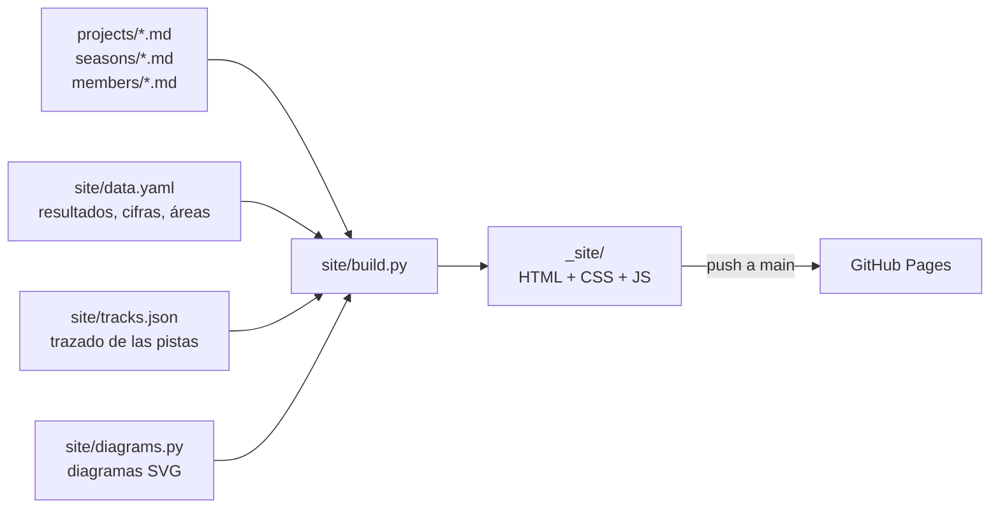

# Guía de entrada al portafolio

Para quien va a escribir o mantener el portafolio del equipo (<https://elyos-racing.github.io/team-portfolio/>). Para el contenido basta saber Markdown; para tocar el sitio, Python básico, HTML y CSS.

> Las reglas de edición están en [`CONTRIBUTING.md`](../CONTRIBUTING.md): temporadas, historial, redacción y flujo de PR. Esta guía explica **cómo funciona el sitio** y por dónde empezar.

## 1. Qué es y para quién

Es el **CV del equipo**: qué construimos, cómo funciona, qué medimos y quién lo hizo. Lo leen gente de fuera (patrocinadores, jueces de premios, reclutadores), así que **el contenido va en inglés**. Las guías, los issues y los PR van en español (regla 11 de la gobernanza).

**Nunca se publica:** código, esquemáticos, CAD, nombres de archivos internos ni datos personales. Cada cifra necesita una fuente (resultado oficial, medición fechada o documento del equipo).

## 2. Cómo se arma el sitio

No hay framework: un script de Python convierte el Markdown y un YAML en HTML estático, y GitHub lo publica.



| Pieza | Qué hace |
|---|---|
| `site/build.py` | Lee el Markdown con la librería `markdown`, arma cada página con su plantilla, calcula las anotaciones de la pista y escribe `_site/` |
| `site/data.yaml` | **Fuente única** de la portada: resultados oficiales (también la tabla del README), cifras grandes y lista de áreas |
| `site/diagrams.py` | Un diagrama SVG "dibujado a mano" por cada página de ingeniería |
| `site/tracks.json` | Contorno de Indianápolis y del Silesia Ring, de las coordenadas oficiales procesadas por los pipelines de pista del equipo |
| `site/style.css`, `site/site.js` | Un solo tema oscuro; animaciones progresivas (si el JS falla, la página se lee igual) |
| `site/car3d.js`, `assets/car.glb` | Visor 3D del coche 2026, con three.js cargado solo cuando la sección se acerca a la pantalla |
| `.github/workflows/pages.yml` | En cada PR revisa que el sitio compile; en cada push a `main`, lo publica |

**La animación de la pista** de la portada no es un video: un punto recorre el contorno con un perfil de velocidad calculado de la **curvatura** de las coordenadas oficiales (límite de agarre lateral, suavizado). Es SVG puro (`stroke-dashoffset` y `transform`), se detiene fuera de pantalla y respeta *reduced motion*.

## 3. Correrlo en tu computadora

```bash
pip install markdown pyyaml
python site/build.py --serve 8000     # construye y sirve en http://localhost:8000/
python site/build.py --check-readme   # lo que revisa el CI: la tabla del README coincide con data.yaml
python site/build.py --write-readme   # reescribe esa tabla después de cambiar resultados en data.yaml
```

Usa `--serve` y no `python -m http.server`: los enlaces no llevan `.html` (GitHub Pages sirve `/mileage` desde `mileage.html`), y `--serve` imita eso.

## 4. Qué editar según lo que quieras hacer

| Quiero... | Archivo | Detalle |
|---|---|---|
| Contar un avance de mi área | `projects/<área>.md` | Arriba el estado actual; abajo `## History`, con la temporada más nueva primero |
| Escribir la bitácora del año | `seasons/<año>.md` | El sitio le agrega solo las entradas de cada área de ese año |
| Agregar mi página de miembro | `members/<tu-usuario>.md` | Copia `members/TEMPLATE.md`. **Solo tú puedes abrir ese PR**: es tu consentimiento para publicarla |
| Agregar un resultado | `site/data.yaml` (`results:`) | Con su `circuit`; después `--write-readme` |
| Cambiar colores, tipografía o diagramas | `site/style.css`, `site/diagrams.py` | Antes, lee [`site/STYLE.md`](../site/STYLE.md) |

## 5. Primera tarea

1. Corre el sitio en local (sección 3) y recórrelo completo.
2. Crea tu página de miembro desde la plantilla y ábrela como PR.
3. Pide a tu líder de área una medición fechada reciente y agrégala al `## History` del área, con su fuente y siguiendo las reglas de redacción.

## Glosario

| Término | Qué es |
|---|---|
| **GitHub Pages** | Hosting gratis de GitHub para sitios estáticos |
| **Markdown** | Texto con marcas simples (`#`, `**`, `|`) que se convierte en HTML |
| **Sitio estático** | HTML ya generado; no hay servidor ni base de datos |
| **SVG** | Gráficos vectoriales en texto: se ven nítidos a cualquier tamaño y se animan con CSS o JS |
| **Tag `season-<año>`** | Foto congelada del repo al cerrar una temporada |
| **YAML** | Formato de datos legible (`clave: valor`), como el de `data.yaml` |
